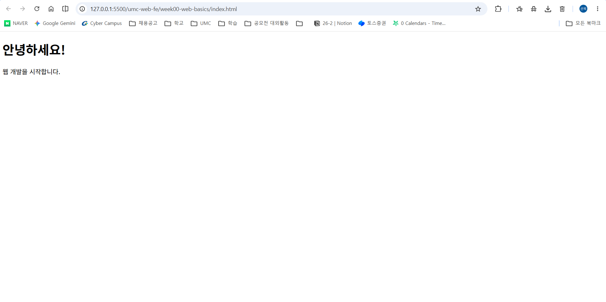
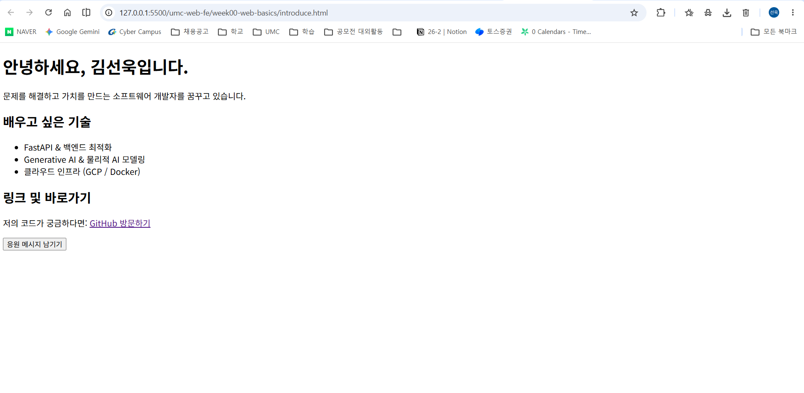
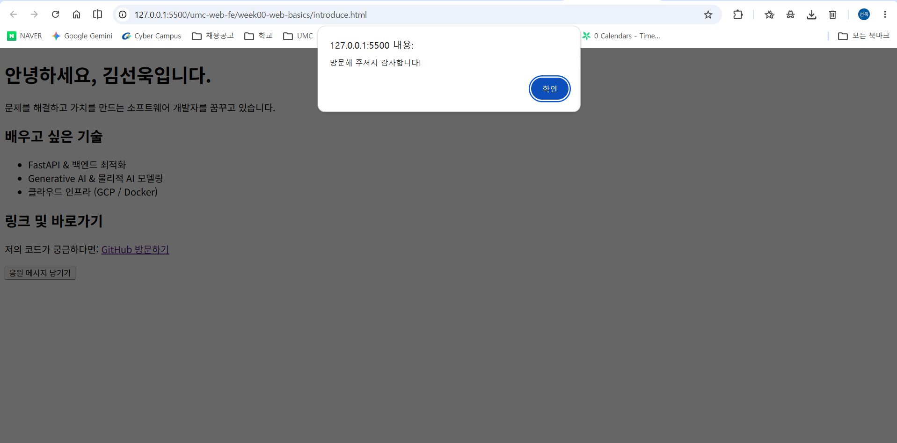
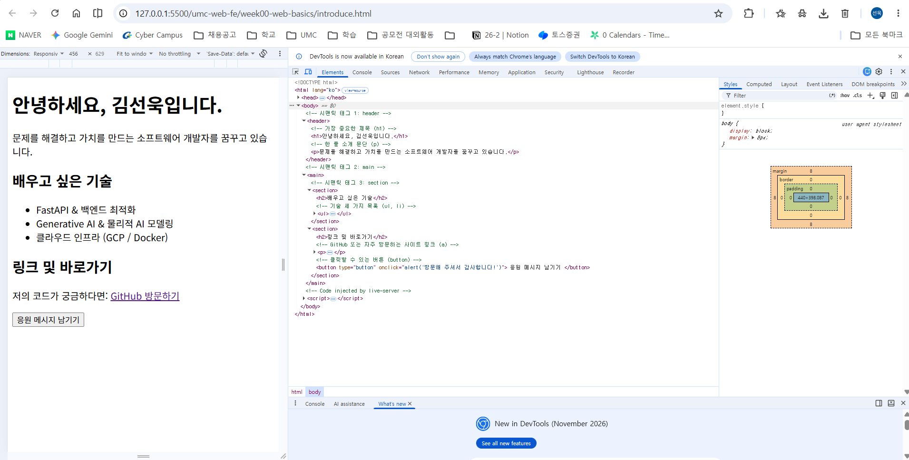

# 0주차 캡처 체크리스트

`week00-web-basics/`의 HTML 파일을 VS Code Live Server로 열어 찍은 캡처.

| 파일 이름 | 무엇을 찍나 | 상태 |
|---|---|---|
| `01-first-page.png` | 첫 웹페이지 결과 화면 (`index.html`) | ✅ |
| `02-introduce.png` | 자기소개 페이지 전체 (`introduce.html`) | ✅ |
| `03-introduce-alert.png` | "응원 메시지 남기기" 버튼을 눌러 alert가 뜬 장면 | ✅ |
| `04-devtools-elements.png` | 개발자 도구 Elements 탭에서 `header`, `main`, `section` 구조 | ✅ |

## 미리보기

### 첫 웹페이지

### 자기소개 페이지

### 버튼 클릭 alert

### Elements 탭의 시맨틱 태그 구조

