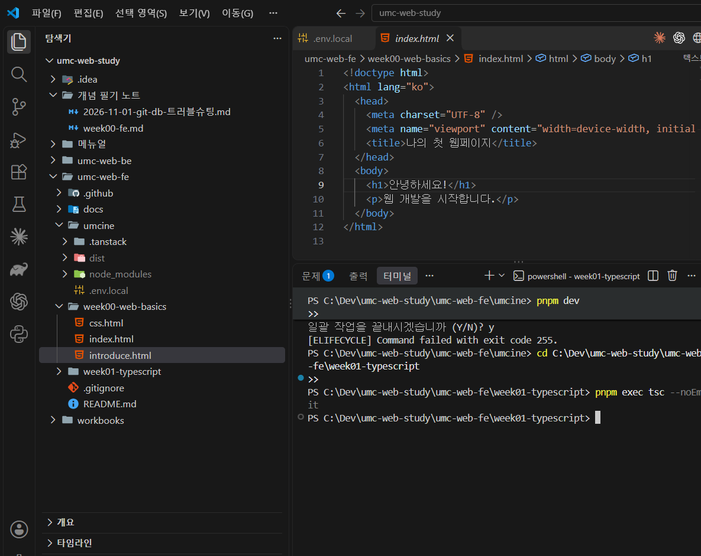
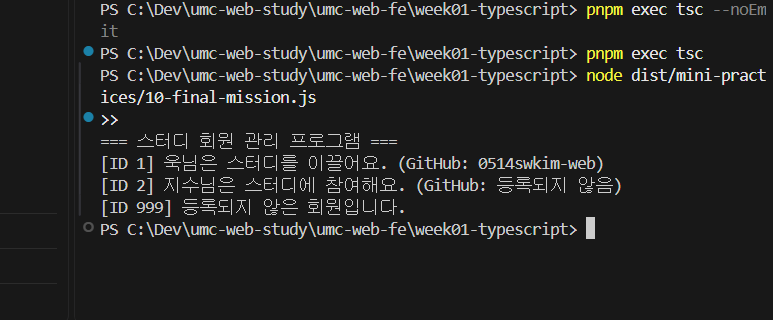
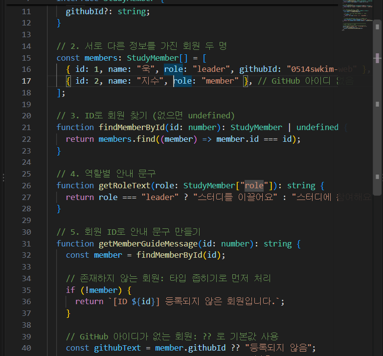

# 1주차 캡처 체크리스트

`week01-typescript` 폴더 터미널에서 실행한 캡처.

| 파일 이름 | 무엇을 찍나 | 명령 | 상태 |
|---|---|---|---|
| `01-tsc-noemit.png` | 타입 검사가 아무 오류 없이 끝난 터미널 | `pnpm exec tsc --noEmit` | ✅ |
| `02-mission-run.png` | 회원 ID 1, 2, 999 실행 결과 3줄 | `pnpm exec tsc` → `node dist/mini-practices/10-final-mission.js` | ✅ |
| `03-mission-code.png` | (선택) `githubId?: string`과 `??` 부분 코드 | VS Code에서 `10-final-mission.ts` | ✅ |

> 캡처 후 생긴 `dist/` 폴더는 `.gitignore`에 있어서 올라가지 않아요.

## 미리보기

### 타입 검사 통과

### 미션 실행 결과

### 미션 코드 (선택 속성과 `??`)

