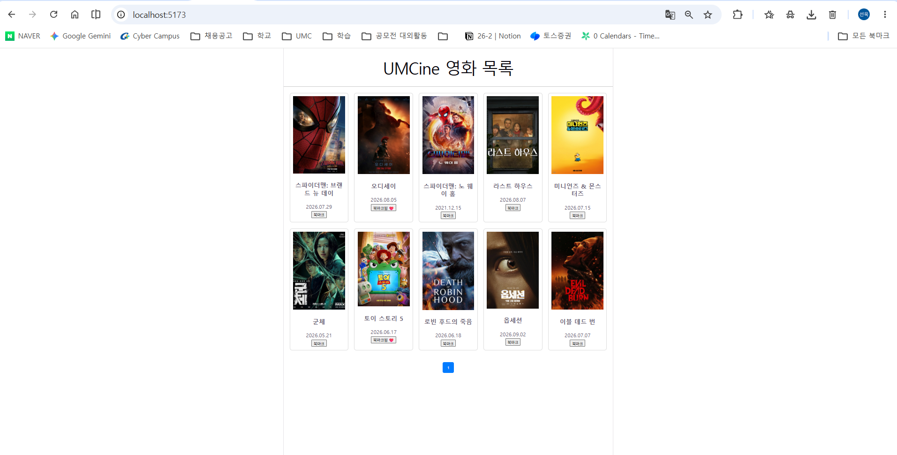
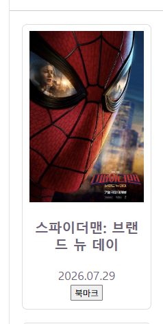
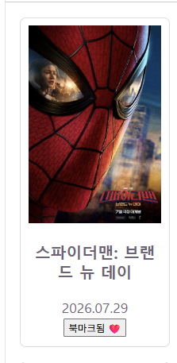
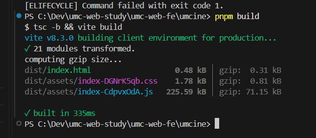

# 2주차 캡처 체크리스트

`umcine` 폴더에서 `pnpm install` → `pnpm dev`로 띄운 화면과 `pnpm build` 결과.

| 파일 이름 | 무엇을 찍나 | 상태 |
|---|---|---|
| `01-movie-list.png` | UMCine 영화 목록 화면 전체 (Figma와 비교되는 데스크톱 화면) | ✅ |
| `02-bookmark-before.png` | 북마크 누르기 전 카드 | ✅ |
| `03-bookmark-after.png` | 북마크 누른 뒤 아이콘이 바뀐 카드 | ✅ |
| `04-build.png` | `pnpm build` 성공 터미널 | ✅ |
| `05-practice.png` | (선택) 미니 실습 하나 실행 화면 (예: `6.state_event` 카운터) | 건너뜀 |

## 미리보기

### UMCine 영화 목록

### 북마크 전 / 후
 

### 빌드 성공

