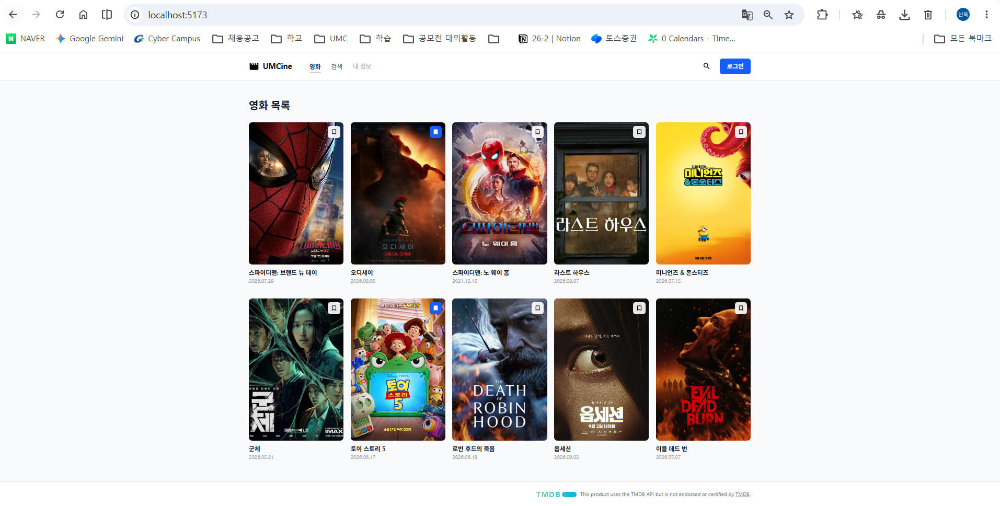
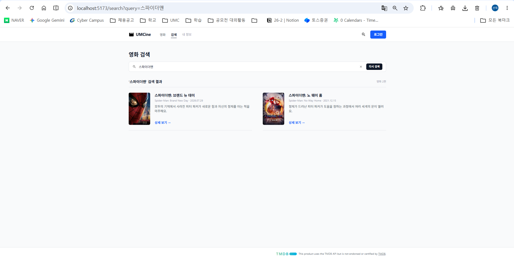
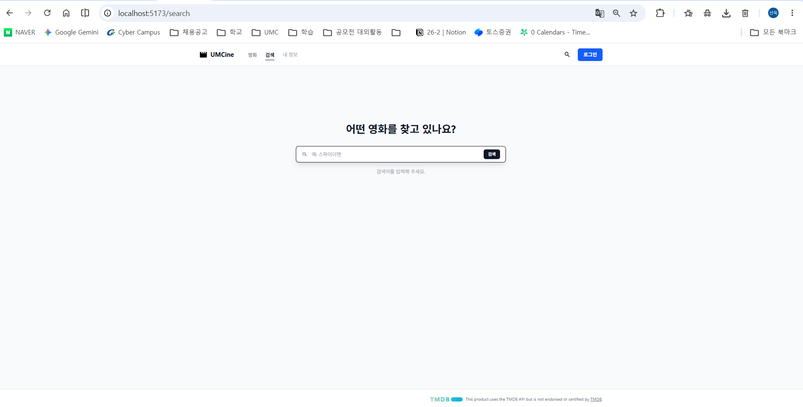
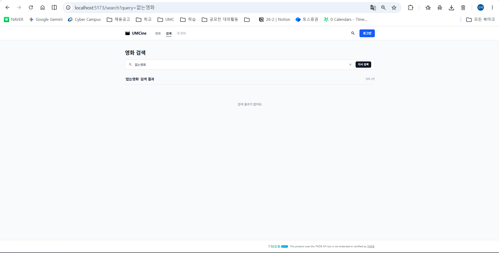
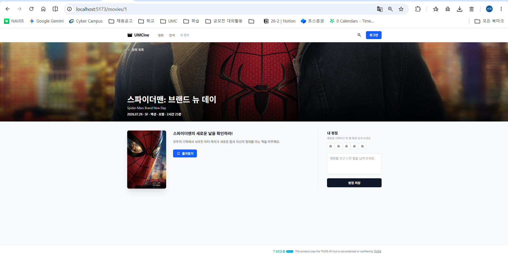
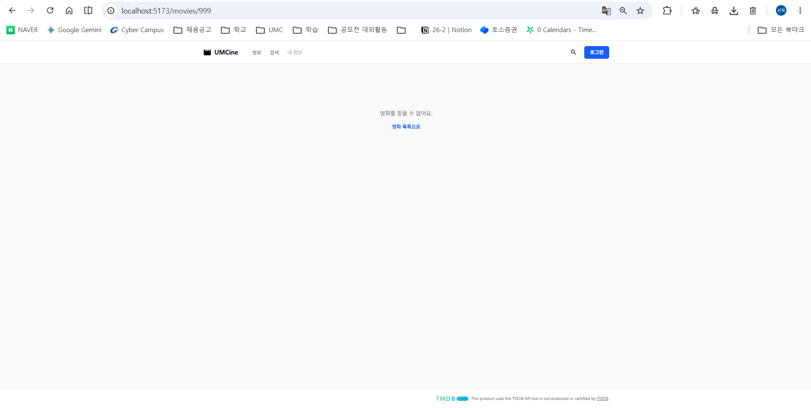
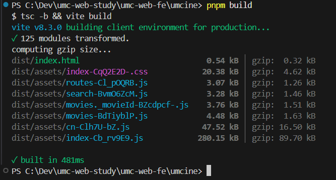
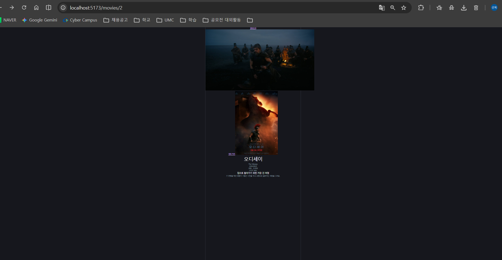
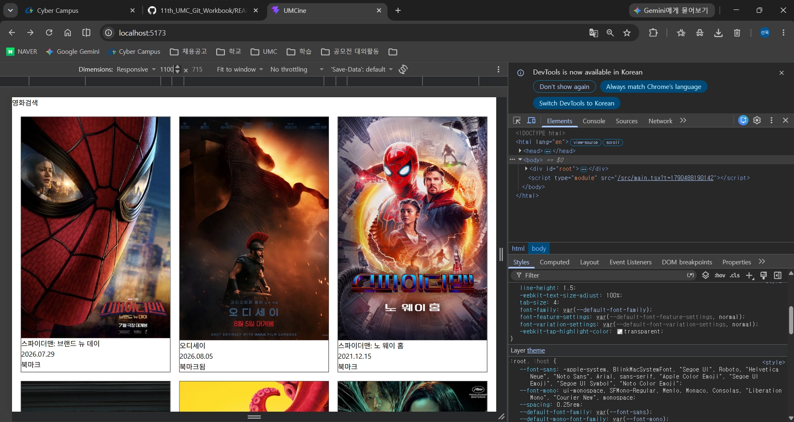
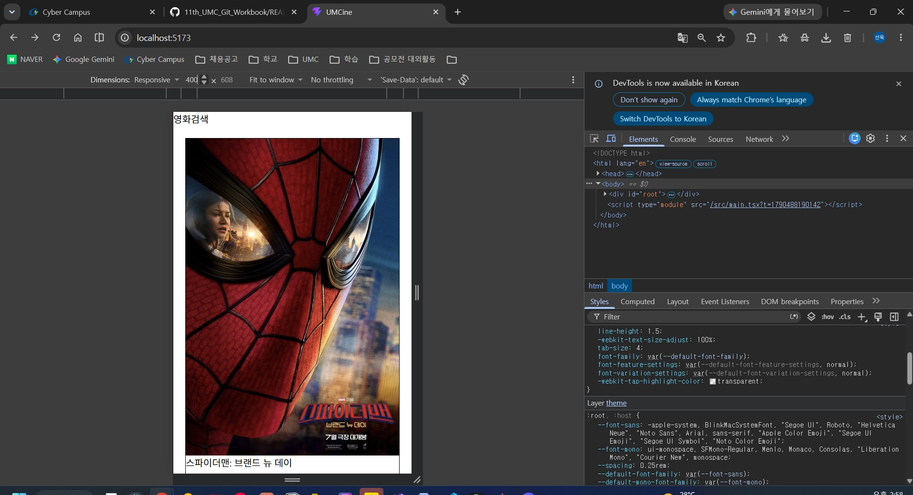

# 3주차 캡처 체크리스트

`umcine` 폴더에서 `pnpm install` → `pnpm dev`로 띄운 화면과 `pnpm build` 결과.

| 파일 이름 | 무엇을 찍나 | 상태 |
|---|---|---|
| `practice-card-link.png` | 카드 클릭 → 상세 이동 | ✅ 예전 캡처 |
| `practice-moviecard-desktop.png` | Tailwind MovieCard 데스크톱 | ✅ 예전 캡처 |
| `practice-moviecard-mobile.png` | Tailwind MovieCard 모바일 | ✅ 예전 캡처 |
| `01-list.png` | `/` 영화 목록 (Figma 데스크톱과 비교) | ✅ |
| `02-search-result.png` | `/search?query=스파이더맨` 검색어·결과 수·카드 | ✅ |
| `03-search-empty-query.png` | `/search` 검색어 없음 안내 | ✅ |
| `04-search-no-result.png` | `/search?query=없는영화` 결과 없음 안내 | ✅ |
| `05-detail.png` | `/movies/1` 상세 (배경 이미지 포함) | ✅ |
| `06-detail-not-found.png` | `/movies/999` "영화를 찾을 수 없어요." | ✅ |
| `07-build.png` | `pnpm build` 성공 + Console 오류 없음 | ✅ |

## 미리보기

### 영화 목록

### 검색 결과

### 검색어 없음 / 결과 없음

### 영화 상세

### 없는 영화

### 빌드 성공

### 미니 실습 (예전 캡처)

