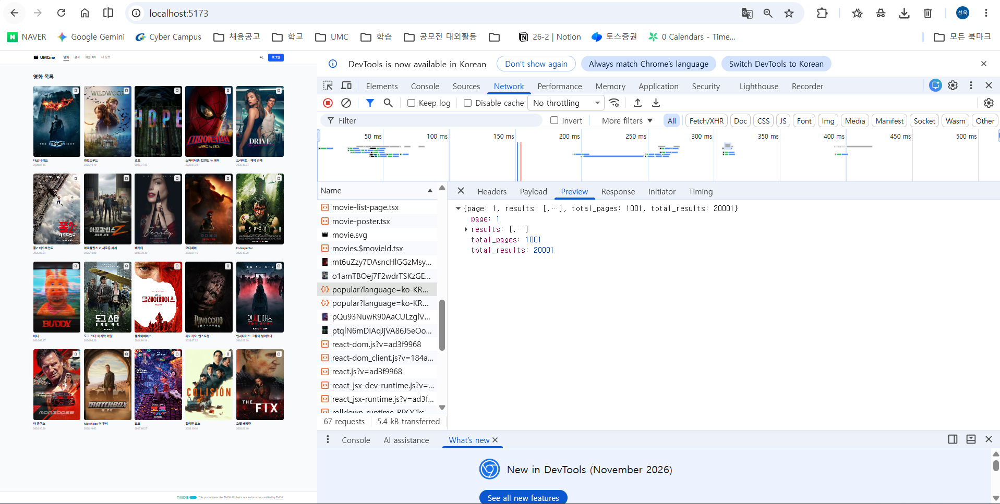
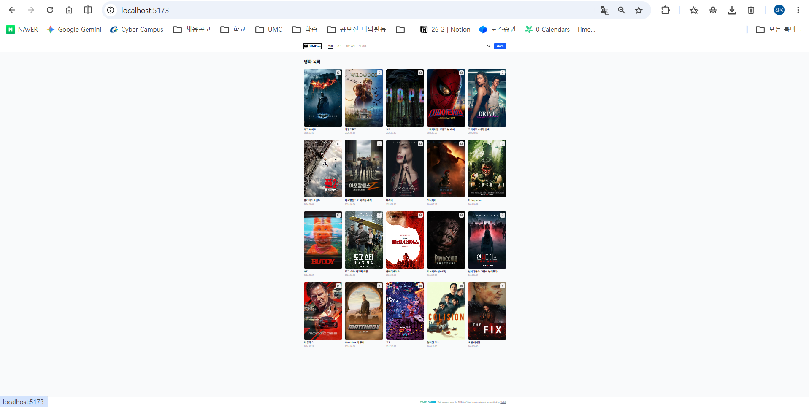
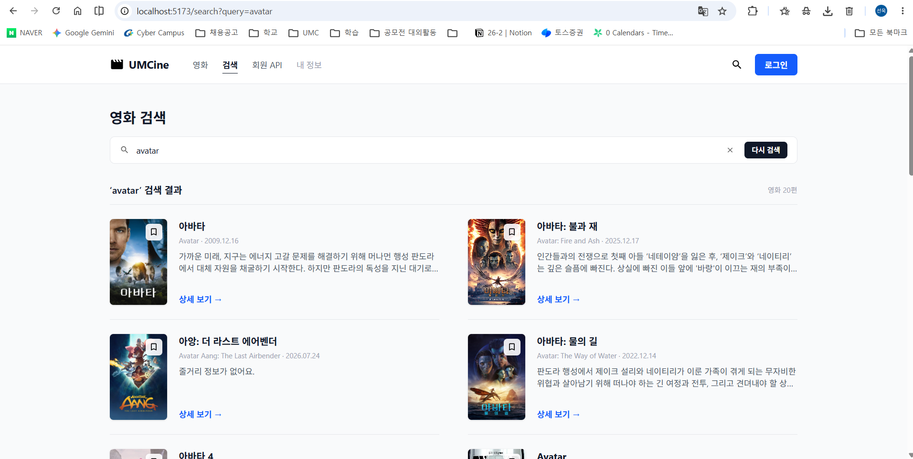
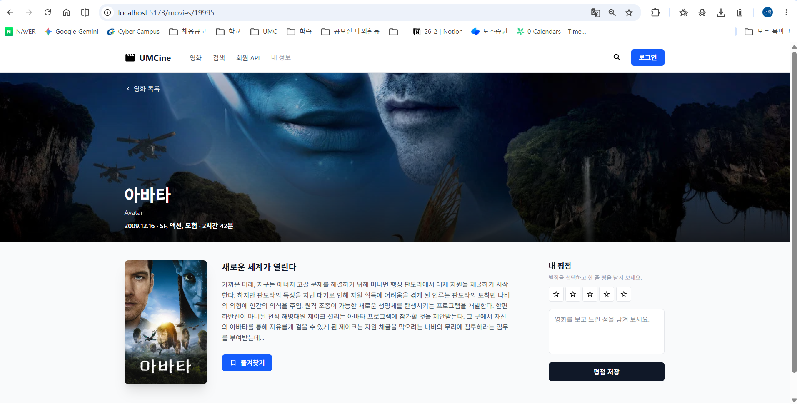
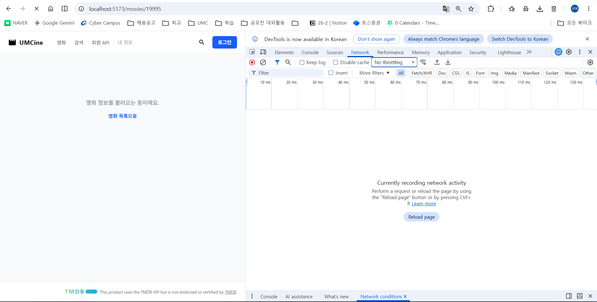
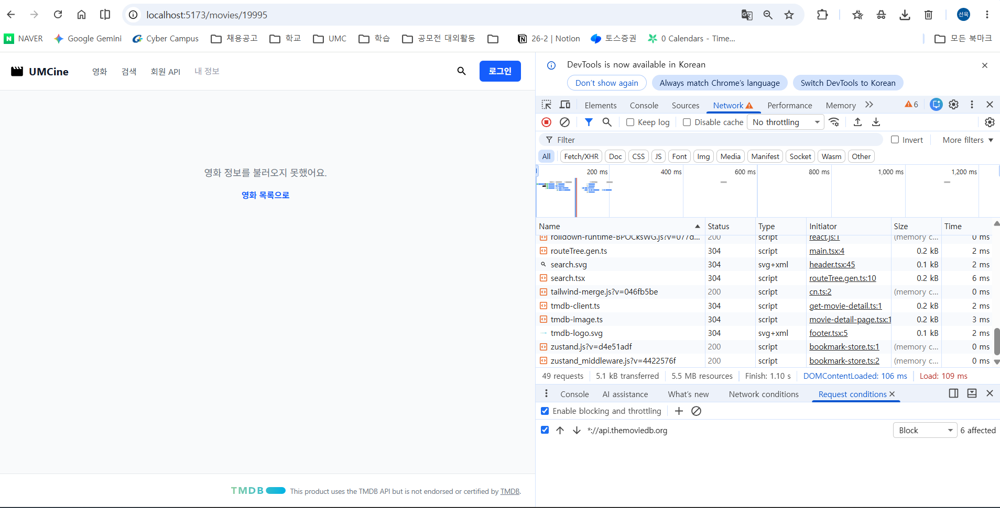
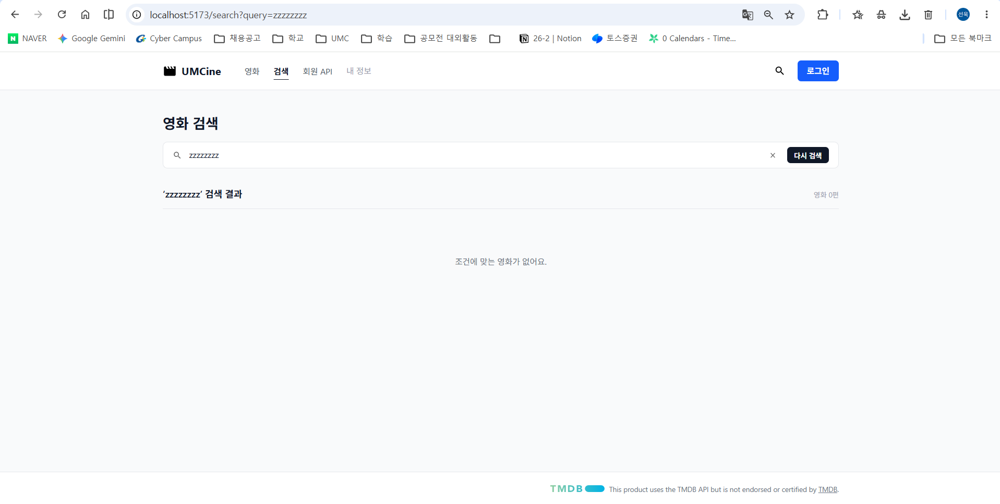
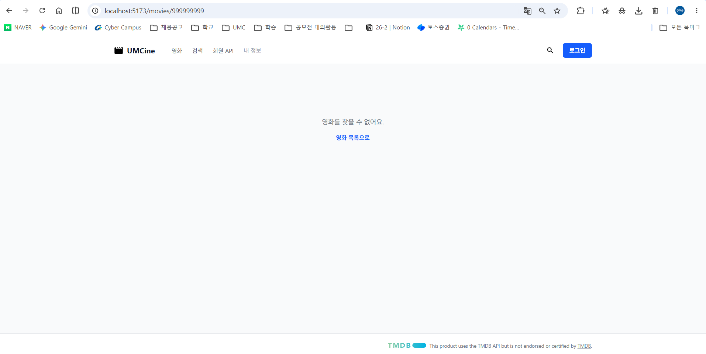
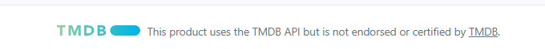
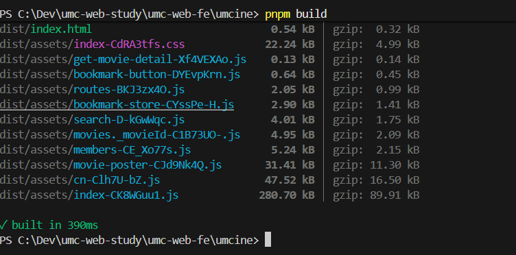

# 5주차 캡처 체크리스트

`umcine/.env.local`에 TMDB 토큰을 넣고 `pnpm dev`로 띄운 화면과 `pnpm build` 결과.

| 파일 이름 | 무엇을 찍나 | 상태 |
|---|---|---|
| `01-network-fetch.png` | F12 → Network에서 TMDB `movie/popular` 요청과 응답(Preview) | ✅ |
| `02-list.png` | `/` TMDB 인기 영화 목록 | ✅ |
| `03-search.png` | `/search?query=avatar` 검색 결과 | ✅ |
| `04-detail.png` | `/movies/{TMDB id}` 상세 화면 | ✅ |
| `05-loading.png` | 로딩 문구 (Network 속도를 느리게 설정) | ✅ |
| `06-error.png` | 오류 문구 (Network에서 `api.themoviedb.org` 요청 차단) | ✅ |
| `07-empty.png` | 검색 결과 없음 (`/search?query=zzzzzzzz`) | ✅ |
| `08-not-found.png` | 없는 영화 ID (`/movies/999999999`) | ✅ |
| `09-tmdb-credit.png` | 푸터의 TMDB 출처 표기 | ✅ |
| `10-build.png` | `pnpm build` 성공 | ✅ |

## 미리보기

### TMDB 인기 영화 요청과 응답

### 인기 영화 목록

### 검색 결과

### 영화 상세

### 로딩 / 오류

### 검색 결과 없음 / 없는 영화

### TMDB 출처 표기

### 빌드 성공

