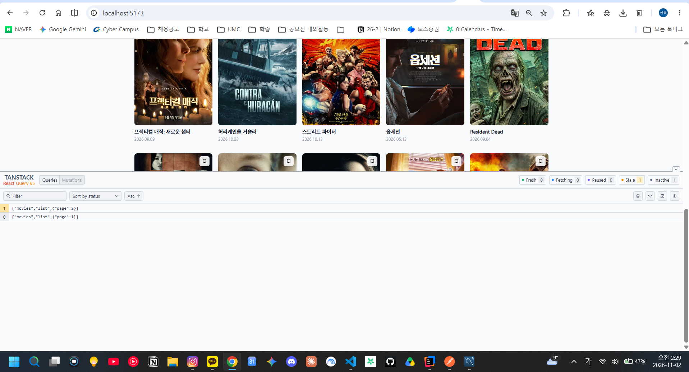
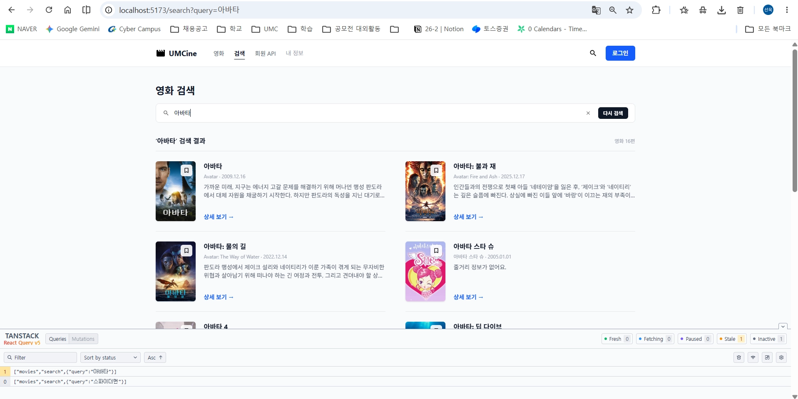
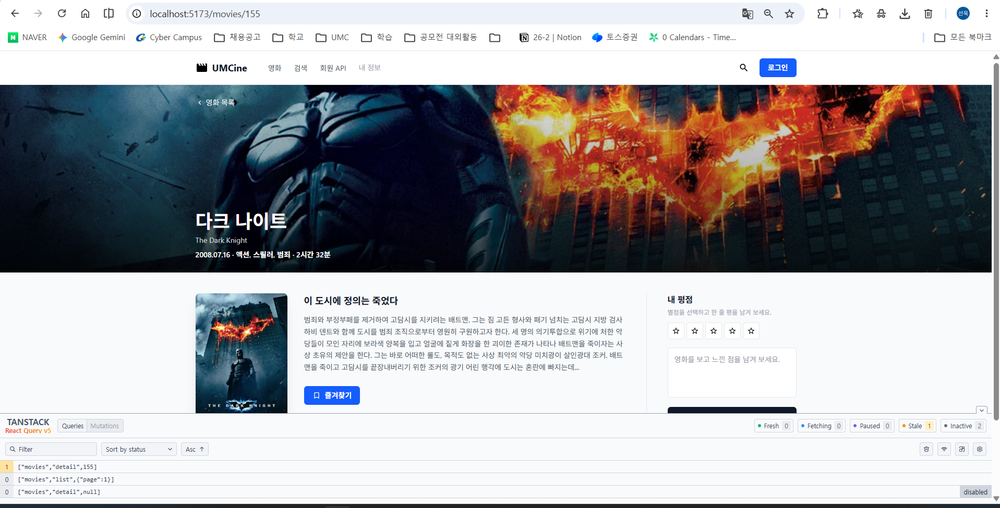
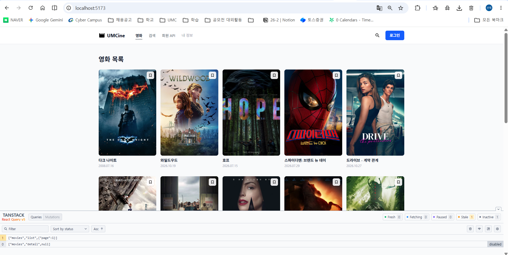
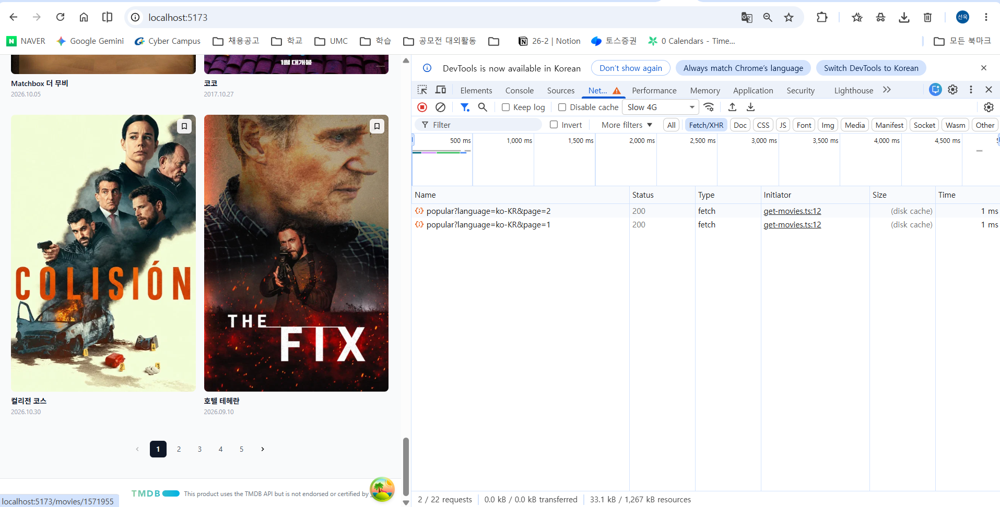
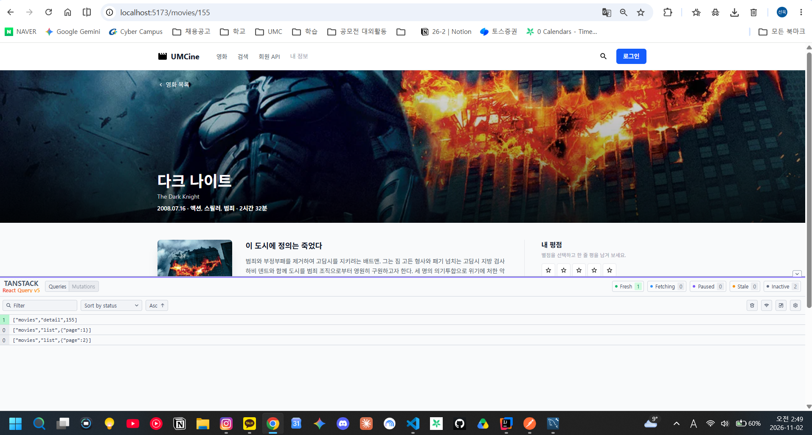
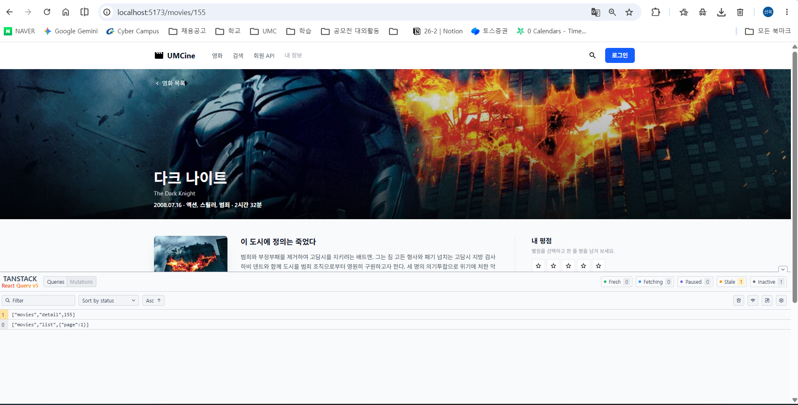
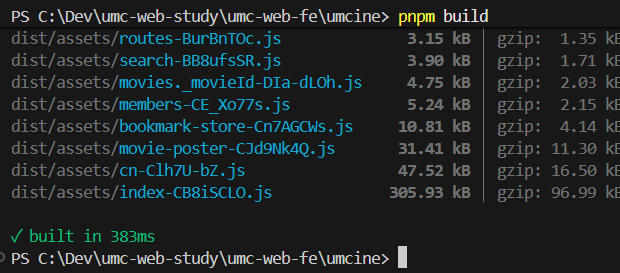

# 6주차 캡처 체크리스트

`umcine`에서 `pnpm dev`로 띄운 화면의 Query 개발자 도구(화면 오른쪽 아래 아이콘)와 Network 탭, `pnpm build` 결과.

| 파일 이름 | 무엇을 찍나 | 상태 |
|---|---|---|
| `01-list-query-keys.png` | 목록 1·2페이지 이동 후 `["movies","list",{page}]` 캐시 2개 | ✅ |
| `02-search-query-keys.png` | 검색어 두 개로 검색 후 `["movies","search",{query}]` 캐시 2개 | ✅ |
| `03-detail-query.png` | 상세 화면과 `["movies","detail",155]` 캐시 | ✅ |
| `04-detail-disabled.png` | 잘못된 ID(`/movies/abc`)로 생긴 `["movies","detail",null]`이 disabled | ✅ |
| `05-stale-time-network.png` | `staleTime` 1분 적용 후 페이지 2→1→2→1 이동해도 요청 2개뿐 | ✅ |
| `06-detail-fresh.png` | 상세 `staleTime` 30초: 조회 직후 Fresh | ✅ |
| `07-detail-stale.png` | 30초 뒤 상세가 Stale로 바뀜 | ✅ |
| `08-build.png` | `pnpm build` 성공 | ✅ |

## 미리보기

### 페이지별 query key

### 검색어별 query key

### 상세 query와 enabled로 막힌 잘못된 ID

### staleTime 1분: 이미 본 페이지는 다시 요청하지 않음

### 상세 staleTime 30초: Fresh → Stale

### 빌드 성공

