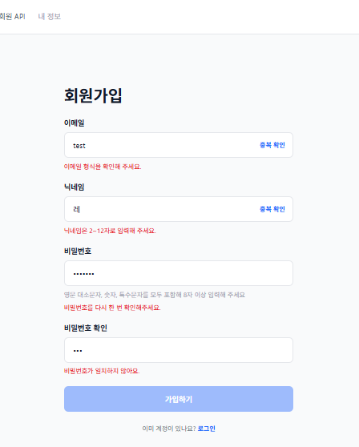
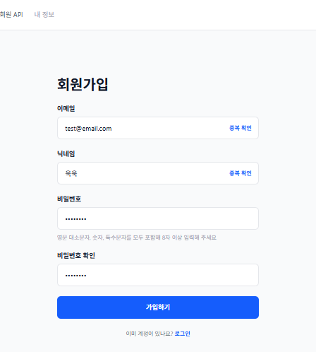
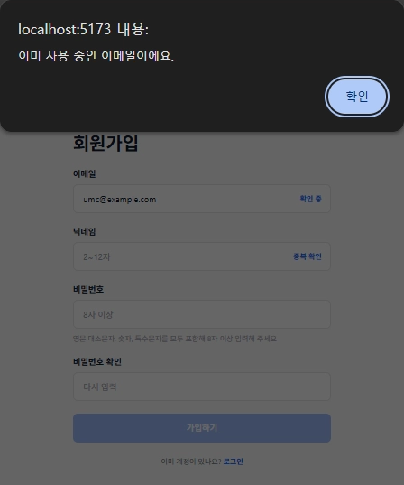
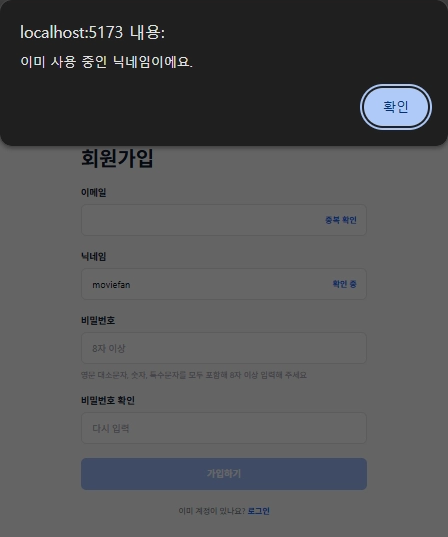
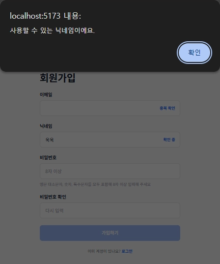
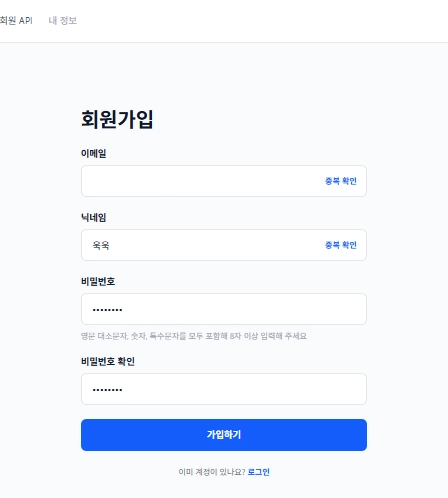
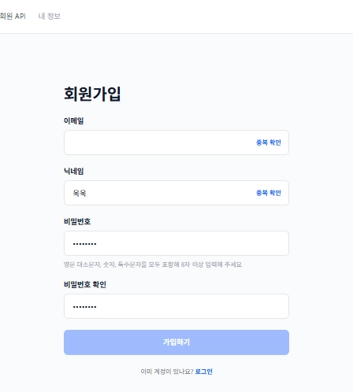

# 7주차 캡처 체크리스트

`umcine`에서 `pnpm dev`로 띄운 `/signup` 화면과 `umc-web-be/movie` 서버를 연결한 결과.

04~08번의 이메일 값은 공개 레포에 올리기 전에 가렸다.

| 파일 이름 | 무엇을 찍나 | 상태 |
|---|---|---|
| `01-signup-validation-errors.png` | 3.2 입력 조건을 만족하지 못한 네 칸의 오류 문구 | ✅ |
| `02-signup-form-valid.png` | 3.2 입력 조건을 모두 만족해 오류가 사라짐 | ✅ |
| `03-email-duplicate.png` | 3.3 이미 사용 중인 이메일 | ✅ |
| `04-email-available.png` | 3.3 사용할 수 있는 이메일 | ✅ |
| `05-nickname-duplicate.png` | 3.3 이미 사용 중인 닉네임 | ✅ |
| `06-nickname-available.png` | 3.3 사용할 수 있는 닉네임 | ✅ |
| `07-can-submit.png` | 3.3 입력 조건과 두 중복 확인을 통과해 가입하기 활성화 | ✅ |
| `08-recheck-required.png` | 3.3 확인한 이메일을 고치면 가입하기가 다시 비활성화 | ✅ |

## 미리보기

### 3.2 입력값 검증

### 3.3 이메일 중복 확인

### 3.3 닉네임 중복 확인

### 3.3 가입하기 활성화와 재확인

