# 8주차 캡처 체크리스트

`umcine`에서 `pnpm dev`로 띄운 화면과 `umc-web-be/movie` 서버(8주차 `/favorites` 포함)를 연결한 결과.

공개 레포에 올리기 전에 이메일 값은 가리고, 브라우저 탭·북마크 줄·프로필은 잘라 냈다.

| 파일 이름 | 무엇을 찍나 | 워크북 위치 | 상태 |
|---|---|---|---|
| `01-signup-mutation-success.png` | 1.2 회원가입을 `useMutation`으로 → `onSuccess` 알림 | 실습 1 | ✅ |
| `02-login-success.png` | 2.4 로그인 성공 알림 (버튼 "로그인 중" = `isPending`) | 실습 2 | ✅ |
| `03-login-header-nickname.png` | 2.3·2.4 `invalidateQueries` 뒤 헤더에 내 닉네임 | 실습 2 | ✅ |
| `04-login-redirect-home.png` | 2.4 로그인 상태로 `/login` 열면 `beforeLoad`가 홈으로 | 실습 2 | ✅ |
| `05-me-page-temp-store-mismatch.png` | 헤더(query 캐시) 욱욱님 vs 본문(임시 store) moviefan | 트러블 슈팅 1 (수정 전) | ✅ |
| `06-login-failure.png` | 2.4 틀린 비밀번호 → `onError` 실패 알림 | 실습 2 | ✅ |
| `07-me-page-query-cache.png` | 내 정보 화면을 query 캐시 하나로 → 헤더와 일치 | 트러블 슈팅 1 (수정 후) | ✅ |
| `08-update-me-success-alert.png` | 3.1 닉네임 수정 성공 알림 | 실습 3 | ✅ |
| `09-update-me-header-body-synced.png` | 3.1 `setQueryData` 뒤 헤더·본문 함께 변경 | 실습 3 | ✅ |
| `10-update-me-network-patch-only.png` | 3.1 Network: `PATCH /members/me` 뒤 GET 없음 | 실습 3 · 선택 미션 비교 | ✅ |
| `11-auth-guard-redirect-login.png` | 미션 ① 로그아웃 상태로 `/me` → `(auth)` 레이아웃이 `/login`으로 | 필수 미션 ① | ✅ |
| `12-rating-create.png` | 미션 ② 영화 상세 평점 등록 (`POST /ratings`) | 필수 미션 ② | ✅ |
| `13-rating-update.png` | 미션 ② 평점 수정 (`PATCH /ratings/{ratingId}`) | 필수 미션 ② | ✅ |
| `14-rating-delete.png` | 미션 ② 평점 삭제 (`DELETE /ratings/{ratingId}`) | 필수 미션 ② | ✅ |
| `15a-favorite-detail-before.png` | 미션 ② 상세 열 때 `GET /favorites/{movieId}` → "즐겨찾기"(false) | 필수 미션 ② | ✅ |
| `15b-favorite-detail-to-card-sync.png` | 미션 ② 상세에서 `POST /favorites` → 목록 카드에도 북마크 | 필수 미션 ② | ✅ |
| `16-favorite-list-me.png` | 미션 ② 마이페이지 `GET /favorites` | 필수 미션 ② | ✅ |
| `18-favorite-cards-sync.png` | 미션 ② 카드 해제 전 (하트 오브 비스트·오디세이) | 필수 미션 ② | ✅ |
| `17-favorite-card-remove.png` | 미션 ② 카드에서 오디세이 해제 (`DELETE /favorites/{movieId}`) | 필수 미션 ② | ✅ |

## 미리보기

### 1.2 회원가입 useMutation
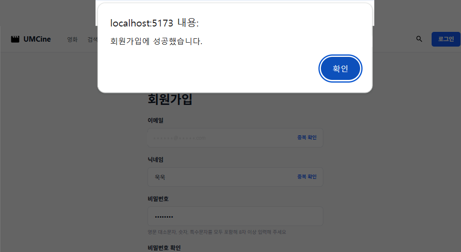

### 2.4 로그인 성공 → 헤더 닉네임
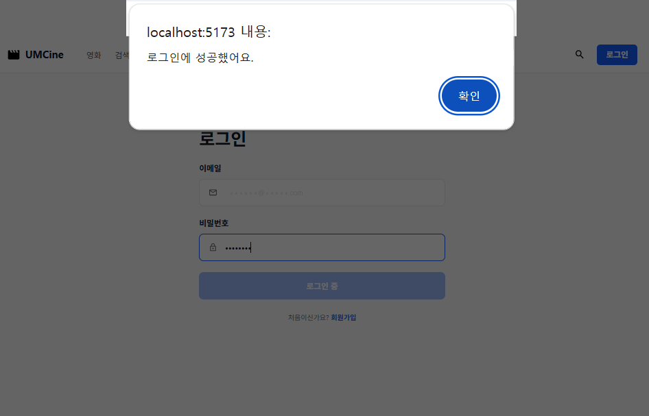
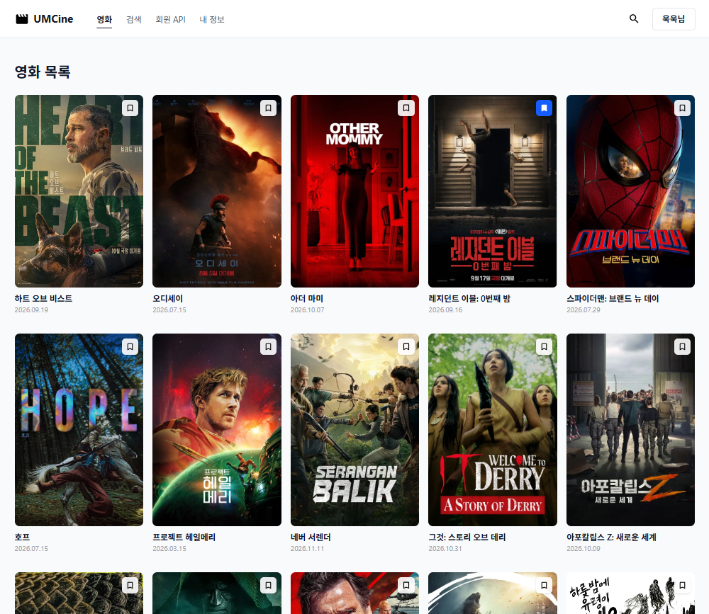

### 2.4 로그인 상태로 /login → 홈
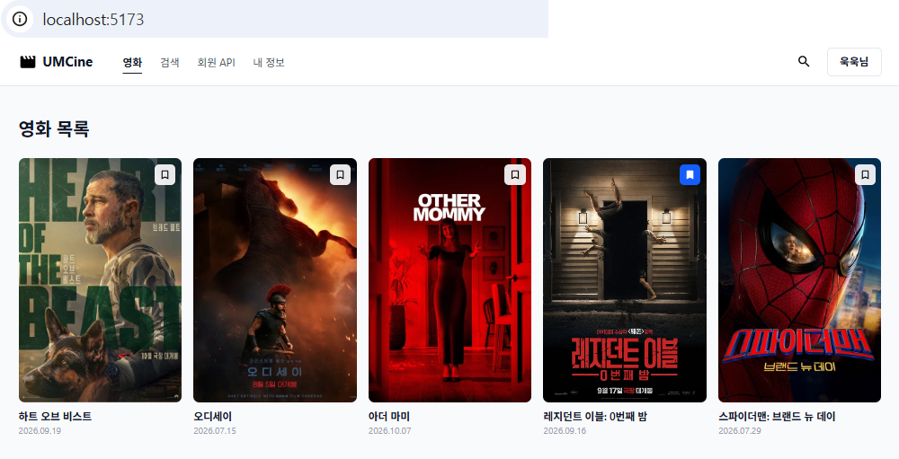

### 2.4 로그인 실패
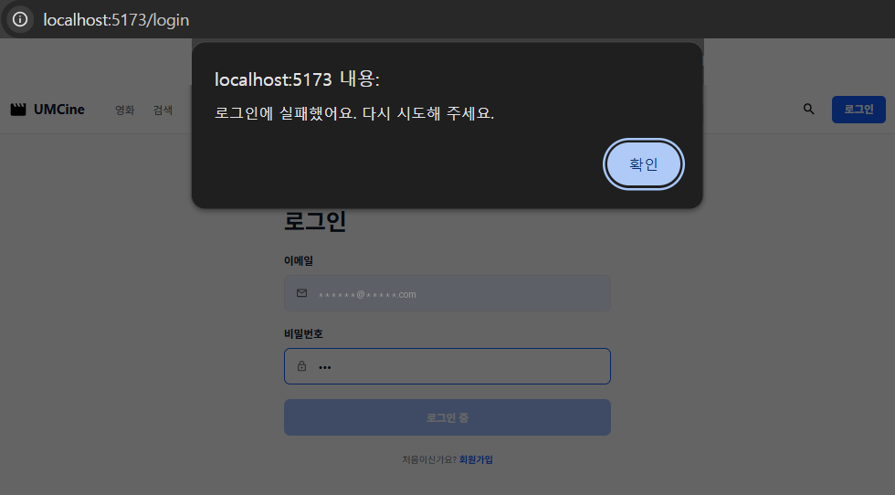

### 트러블 슈팅 1 수정 전 / 후
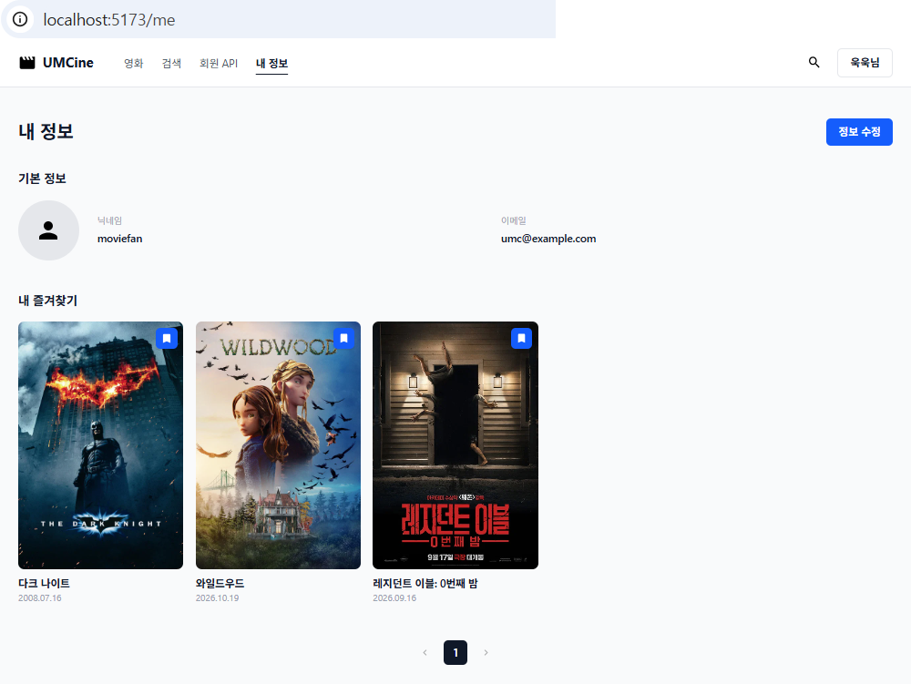

### 3.1 닉네임 수정 + setQueryData
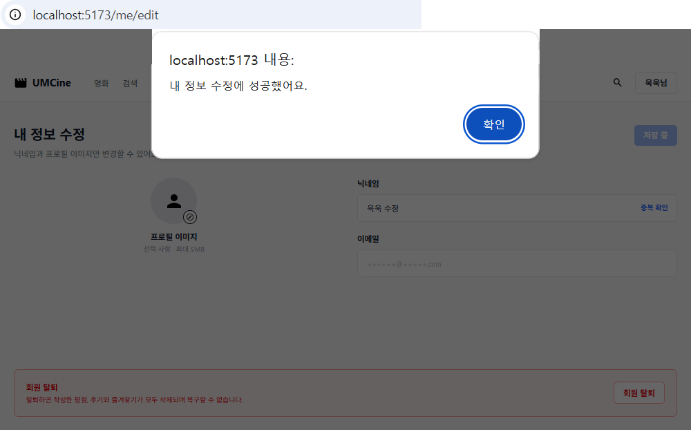
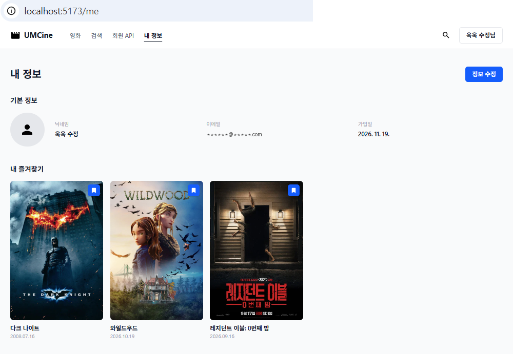
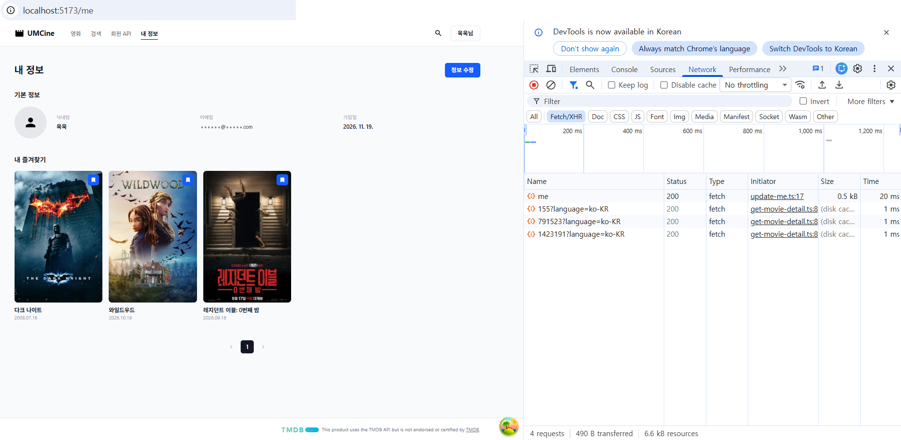

### 미션 ① 로그인 전용 폴더
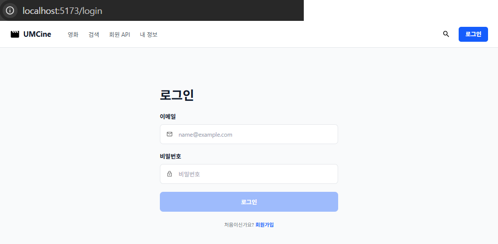

### 미션 ② 평점 등록 / 수정 / 삭제
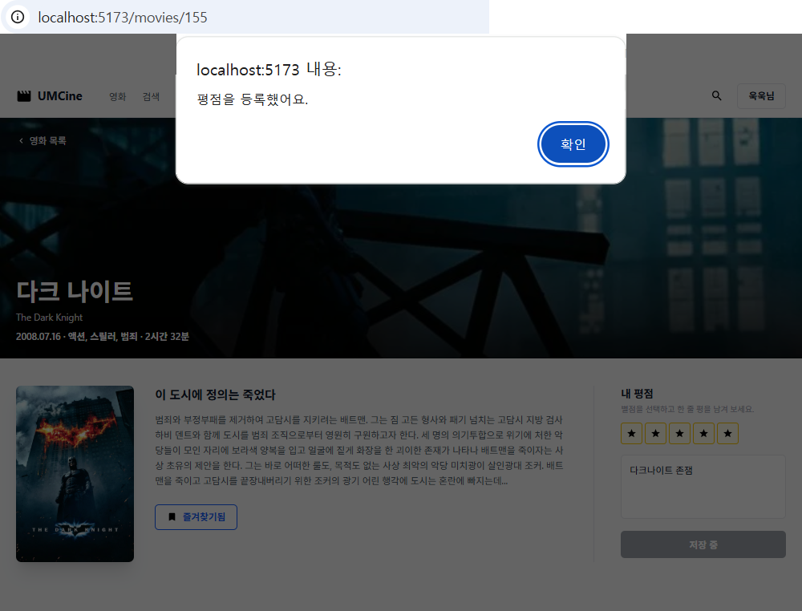

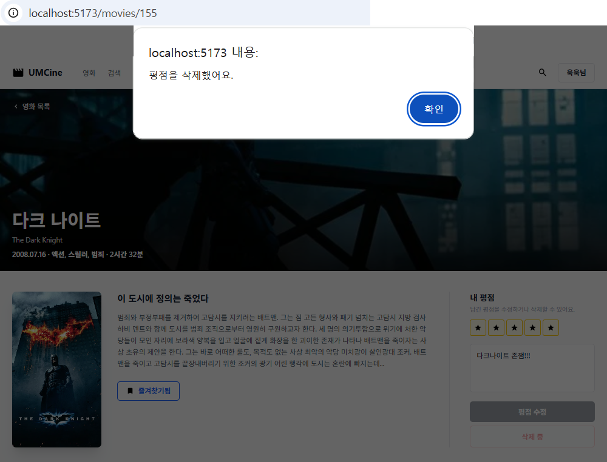

### 미션 ② 즐겨찾기
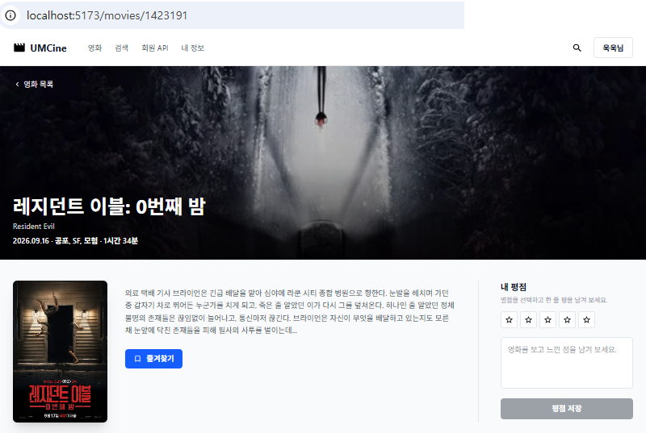
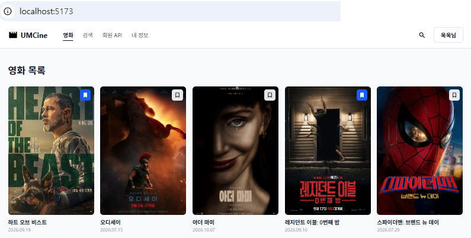
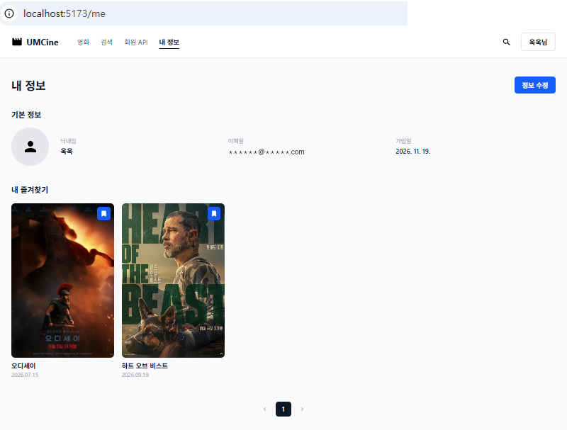
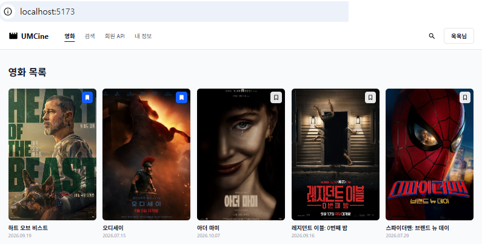

