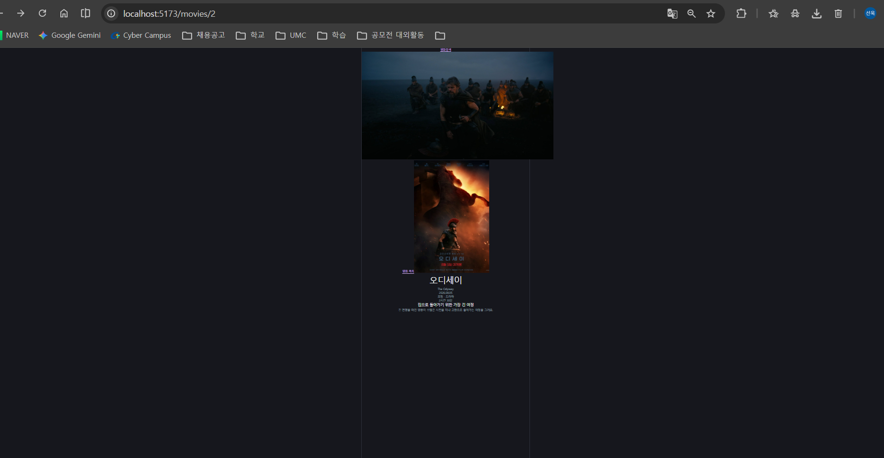
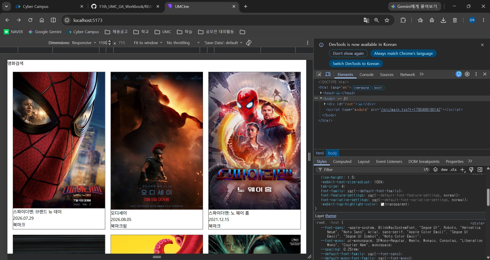
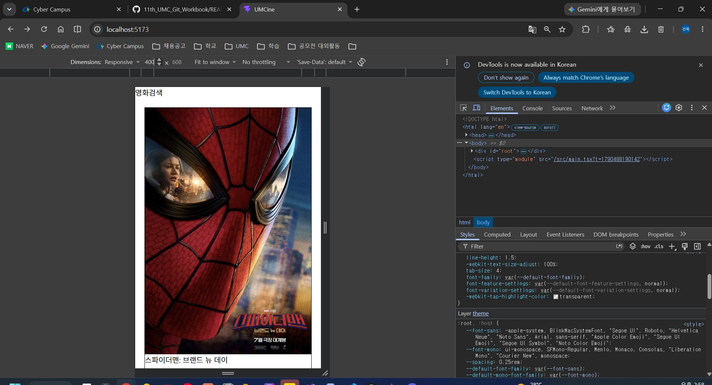

# 3주차 FE: TanStack Router와 Tailwind CSS

> 한 줄 요약: **URL마다 다른 화면을 보여 주는 게 라우팅, class 이름만으로 스타일을 입히는 게 Tailwind.** 주소를 직접 쳐도, 새로고침해도 같은 화면이 나와야 한다.

## 1. 핵심 개념

| 개념 | 쉬운 설명 | 비유 |
|---|---|---|
| **라우팅** | URL 경로에 맞는 화면(컴포넌트)을 골라 보여 주기 | 건물 층별 안내판 |
| **SPA** | 페이지 하나에서 JS가 화면만 갈아 끼움. 새로고침 없이 이동 | 무대 세트만 바꾸는 연극 |
| **파일 기반 라우팅** | `src/routes/` 파일 이름이 곧 URL. 플러그인이 `routeTree.gen.ts`를 자동 생성 | 방 문패가 곧 주소 |
| **`__root.tsx`** | 모든 페이지를 감싸는 공통 레이아웃. 자식은 `<Outlet />` 자리에 나타남 | 액자 틀 |
| **동적 라우트 `$movieId`** | 경로 일부를 변수로 받음. 값은 **항상 문자열** | 호실 번호 칸 |
| **search param** | `?query=...` 형태의 값. `validateSearch`로 타입을 정함 | 주문서의 옵션 칸 |
| **`<Link>`** | 새로고침 없이 이동하는 링크. `to`, `params`, `search` 사용 | 건물 안 엘리베이터 |
| **Tailwind CSS** | `p-4`, `text-sm`, `grid-cols-3`처럼 미리 정해진 class로 스타일 | 이미 잘라 둔 재료 |
| **반응형 접두사** | `md:`, `lg:`는 "그 너비 이상에서만" 적용 (모바일 우선) | 키에 맞춰 바뀌는 옷 |
| **임의 값** | `aspect-[2/3]`, `rounded-[10px]`처럼 대괄호로 정확한 값 | 맞춤 주문 |
| **`cn`** | 조건부 class를 합치고 충돌을 정리해 주는 함수 (`clsx` + `tailwind-merge`) | 옷 코디 정리 도우미 |

## 2. 이번 주 실습 → 파일 위치

| 워크북 단원 | 실습 | 파일 |
|---|---|---|
| 라우터 설정 | 파일 기반 라우트 4개 | [src/routes/](../../umcine/src/routes) |
| 5 | 카드 → 상세 이동 (`Link` + `params`) | [movie-card.tsx](../../umcine/src/components/movies/movie-card.tsx) |
| Tailwind 설치 | Vite 플러그인 연결 | [vite.config.ts](../../umcine/vite.config.ts), [index.css](../../umcine/src/index.css) |
| `cn` 유틸 | 조건부 class 합치기 | [cn.ts](../../umcine/src/utils/cn.ts) |
| 7 | MovieCard 스타일을 utility class로 | [movie-card.tsx](../../umcine/src/components/movies/movie-card.tsx) |

### 미니 실습 기록 (예전 PRACTICE.md에서 옮김)
- **카드에서 상세로 이동**: `<Link to="/movies/$movieId" params={{ movieId: String(movie.id) }}>`. path param은 문자열이라 `String()`으로 변환. 없는 ID(`/movies/999`)는 안내 문구.
  
- **MovieCard Tailwind 이전**: `aspect-[2/3]` + `object-cover`로 포스터 비율 통일, `relative`(카드) + `absolute`(버튼)로 북마크 버튼 띄우기. 북마크 버튼을 `Link` 밖에 두어 눌러도 상세로 이동하지 않게 함. 400px 1열 / 768px 2열 / 1100px 3열 / 1300px 5열에서 겹침 없음.
  
  

### 필수 미션 키워드 → 구현
| 키워드 | 구현 |
|---|---|
| `/`, `/search?query=`, `/movies/$movieId` | [index.tsx](../../umcine/src/routes/index.tsx), [search.tsx](../../umcine/src/routes/search.tsx), [movies.$movieId.tsx](../../umcine/src/routes/movies.$movieId.tsx) |
| 검색어·결과 수·포스터·제목·원제·개봉일·줄거리 | [search-page.tsx](../../umcine/src/pages/movies/search-page.tsx) |
| 검색어 없음 / 결과 없음 안내 | `검색어를 입력해 주세요.` / `검색 결과가 없어요.` |
| 없는 영화 ID | [movie-detail-page.tsx](../../umcine/src/pages/movies/movie-detail-page.tsx) `영화를 찾을 수 없어요.` |
| CSS → Tailwind, `App.css` 제거 | `src/components/`, `src/pages/` 전체 |
| 상태별 class는 `cn` | 헤더 활성 메뉴, 북마크 버튼, 페이지네이션 |
| (선택) 활성 메뉴 스타일 | [header.tsx](../../umcine/src/components/layout/header.tsx) `isActive && activeClass` |

## 3. 자주 하는 실수
- `routeTree.gen.ts`를 손으로 고치기 → 다음 실행 때 덮어써진다. 라우트 파일만 고친다.
- `params={{ movieId: movie.id }}`(숫자) → 타입 오류. 문자열로 변환.
- `` `bg-${color}-500` ``처럼 class 이름 조립 → Tailwind가 못 찾아서 스타일이 안 나온다. 완성된 이름을 쓴다.
- `md:`를 "모바일용"으로 착각 → `md:`는 768px **이상**.

## 4. 스스로 점검하기

Q1. <code>/movies/1</code>에서 새로고침해도 같은 영화가 나오는 이유는?

화면 상태가 아니라 URL(`movieId`)에서 데이터를 찾기 때문.

Q2. <code>cn("px-2", "px-4")</code>의 결과는?

`px-4`. tailwind-merge가 충돌하는 class 중 뒤의 것만 남긴다.

