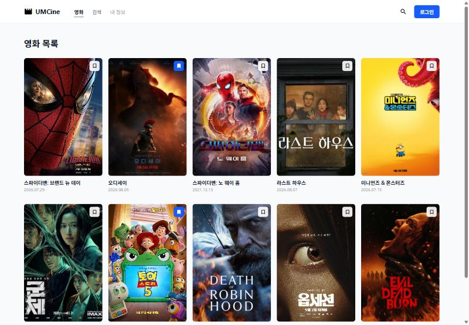

# 4주차 FE: Web Storage와 Zustand 상태 관리

> 한 줄 요약: **Web Storage는 브라우저에 값을 "저장"하고, Zustand는 여러 화면이 값을 "공유"하게 해 준다.** persist로 둘을 묶으면 새로고침해도 공유 상태가 남는다.

## 1. 핵심 개념

| 개념 | 쉬운 설명 | 비유 |
|---|---|---|
| **Web Storage** | 브라우저에 key-value를 저장하는 공간. **문자열만** 저장 | 브라우저 속 사물함 |
| **localStorage** | 탭·브라우저를 닫아도 남음 (같은 출처끼리 공유) | 내 방 서랍 |
| **sessionStorage** | 탭을 닫으면 사라짐 | 호텔 객실 금고 |
| **`JSON.stringify` / `JSON.parse`** | 배열·객체 ↔ 문자열 변환 | 짐을 압축 / 풀기 |
| **지연 초기값** | `useState(() => read())` — 첫 렌더링 때만 저장소를 읽음 | 처음 출근할 때만 열쇠 받기 |
| **전역 상태** | 여러 컴포넌트가 같이 쓰는 상태 | 회사 공용 게시판 |
| **Zustand store** | `create`로 만든 전역 상태 + 바꾸는 함수 묶음 | 공용 게시판 + 관리자 |
| **selector** | `useStore(s => s.ids)`처럼 필요한 값만 구독 → 그 값이 바뀔 때만 다시 그림 | 내 이름 나올 때만 듣는 방송 |
| **persist 미들웨어** | store를 Web Storage에 자동 저장·복원 | 자동 저장 기능 |

## 2. 이번 주 실습 → 파일 위치

| 워크북 단원 | 실습 | 파일 |
|---|---|---|
| 3 | 북마크 ID 배열을 localStorage에 저장 | [bookmark-storage.ts](../../umcine/src/utils/bookmark-storage.ts) |
| Zustand | 북마크 store + BookmarkButton | [bookmark-store.ts](../../umcine/src/stores/bookmark-store.ts), [bookmark-button.tsx](../../umcine/src/components/bookmark-button.tsx) |
| persist | `umcine-bookmark-store`로 저장 | [bookmark-store.ts](../../umcine/src/stores/bookmark-store.ts) |

### 미니 실습 기록 (예전 PRACTICE.md에서 옮김)
- 영화 객체 전체가 아니라 **북마크한 ID 배열만** 상태로 두고 `isBookmarked`는 렌더링할 때 계산.
- 저장값은 사용자가 개발자 도구에서 바꿀 수 있으니 `unknown`으로 받고 `try...catch`, `Array.isArray`로 검사.
- 확인: 오디세이(2), 토이 스토리 5(7) 북마크 → `[2,7]` 저장, 새로고침 후 유지. 값을 `not-json[`으로 망가뜨려도 오류 없이 빈 상태로 복구.
  

### 필수 미션 키워드 → 구현
| 키워드 | 구현 |
|---|---|
| 목록·검색·상세가 같은 북마크 상태 | `useBookmarkStore` — [movie-card.tsx](../../umcine/src/components/movies/movie-card.tsx), [search-page.tsx](../../umcine/src/pages/movies/search-page.tsx), [movie-detail-page.tsx](../../umcine/src/pages/movies/movie-detail-page.tsx) |
| 추가·제거 | store의 `toggleBookmark` |
| Web Storage에 저장·복원 | `persist` + `createJSONStorage(() => localStorage)` |
| 저장 key | `umcine-bookmark-store` |

## 3. 자주 하는 실수
- `localStorage.setItem("ids", [1, 2])` → `"1,2"` 문자열로 저장된다. 반드시 `JSON.stringify`.
- `JSON.parse`를 검사 없이 쓰기 → 값이 망가지면 앱 전체가 터진다.
- `useBookmarkStore()`로 store 전체를 구독 → 아무 값이나 바뀌어도 다시 그려진다. selector로 필요한 것만.
- persist의 `name`을 바꾸면 예전 저장값을 못 읽는다.

## 4. 스스로 점검하기

Q1. localStorage와 sessionStorage의 차이는?

localStorage는 브라우저를 다시 켜도 남고, sessionStorage는 탭을 닫으면 사라진다.

Q2. 북마크를 Context 대신 Zustand로 공유하면 좋은 점은?

Provider로 감쌀 필요가 없고, selector로 필요한 값만 구독해서 불필요한 렌더링이 줄어든다. persist로 저장까지 한 번에 된다.

